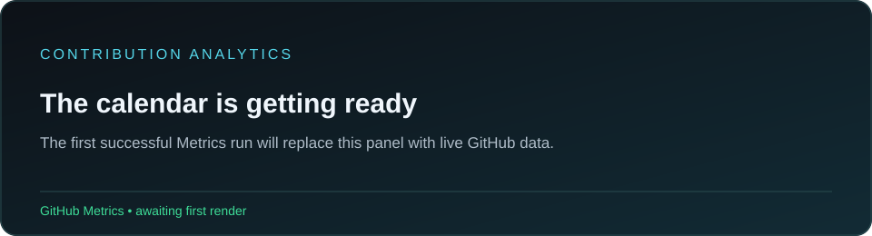
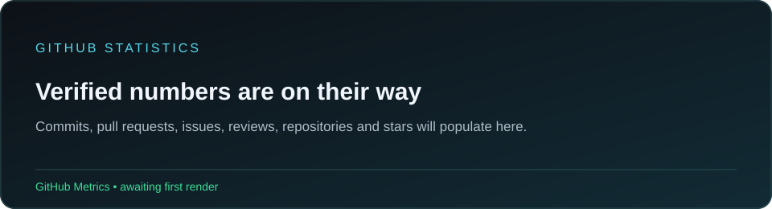
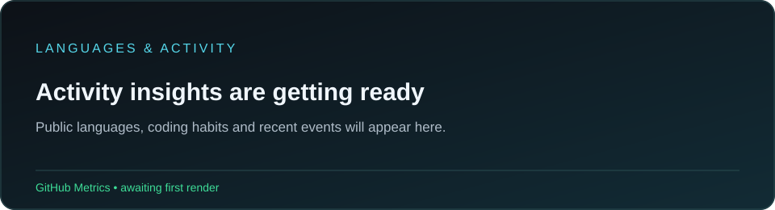
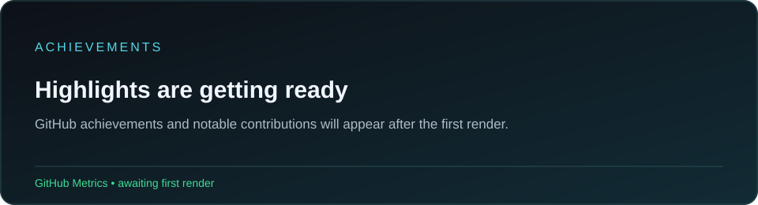

# Hey, I'm Meyank 👋

I build tools that make complicated workflows easier to use. Right now I'm learning computer vision in public through [Kornia](https://github.com/kornia/kornia), exploring Rust and PyO3 in [Kornia-rs](https://github.com/kornia/kornia-rs), and building my own AI and data tools.

  
  
  

**Working with** &nbsp;     

[Projects](#featured-projects) · [Open source](#open-source) · [Contribution analytics](#contribution-analytics)

---

## Contribution analytics

<!-- GitHub Metrics generates these SVGs after the first successful workflow run. -->

## GitHub statistics

## Languages and development activity

The charts come from [GitHub Metrics](https://github.com/lowlighter/metrics) and refresh daily. Counts reflect what GitHub's API makes available to the workflow; private activity depends on token access and profile settings. GitHub Metrics does not expose a reliable current and longest streak pair, so no streak values are claimed here.

## Featured projects

> ### 🔐 [DropVault](https://github.com/Manu-2717/Dropvault)
> **Save something now. Find it by meaning later.** A browser extension and local dashboard for capturing links, notes, and files, then searching them with embeddings. It also extracts text from images and PDFs.
>
> `React` · `FastAPI` · `PyTorch` · `Chrome extension` &nbsp; [Explore the code →](https://github.com/Manu-2717/Dropvault)

> ### 🧭 [CampusPilot](https://github.com/Manu-2717/CampusPilot)
> **Teach a browser task once; reuse the workflow.** CampusPilot navigates a college portal, saves the steps that worked, and repairs them when a selector goes stale.
>
> `React` · `TypeScript` · `FastAPI` · `SQLite` &nbsp; [Explore the code →](https://github.com/Manu-2717/CampusPilot)

> ### 🧩 [FlowWeaver](https://github.com/Manu-2717/flow-weaver)
> **Build data preparation pipelines visually.** A node canvas for cleaning, transforming, and inspecting datasets, with reusable processing nodes and execution feedback.
>
> `Python` · `FastAPI` · `React Flow` · `Polars` &nbsp; [Explore the code →](https://github.com/Manu-2717/flow-weaver)

<strong>What I learned building these</strong>

- **DropVault:** connecting a browser extension, a web app, and local semantic search into one workflow.
- **CampusPilot:** keeping browser automation repeatable by saving and validating each learned step.
- **FlowWeaver:** designing data tools around reusable operations and clear execution feedback.

## Open source

I've been working through real bugs in [Kornia](https://github.com/kornia/kornia)'s augmentation code and contributing to [Kornia-rs](https://github.com/kornia/kornia-rs), including Rust image processing and CI.

- **Kornia:** [Align empty mask and image shapes](https://github.com/kornia/kornia/pull/5706); [replace generic exceptions with specific errors](https://github.com/kornia/kornia/pull/5686); [preserve skipped augmentation inputs](https://github.com/kornia/kornia/pull/5732).
- **Kornia-rs:** [Preserve source rows in spatial padding](https://github.com/kornia/kornia-rs/pull/1193); [check algebra with the `approx` feature in CI](https://github.com/kornia/kornia-rs/pull/1236).
- [See my merged pull requests](https://github.com/search?q=author%3AManu-2717+is%3Apr+is%3Amerged&type=pullrequests) and [issues I've opened](https://github.com/search?q=author%3AManu-2717+is%3Aissue&type=issues).

<strong>What I'm exploring next</strong>

I'm reading through Kornia-rs's Rust and Python bindings, especially how PyO3 turns Rust errors into useful Python exceptions. I'm also continuing to learn how computer vision libraries test numerical and edge-case behavior.

## Achievements and repository highlights

---

If one of these projects is useful to you, I'd like to hear about it. You can find more of my work on my [portfolio](https://meyank-portfolio.vercel.app/) or browse my [repositories](https://github.com/Manu-2717?tab=repositories).
